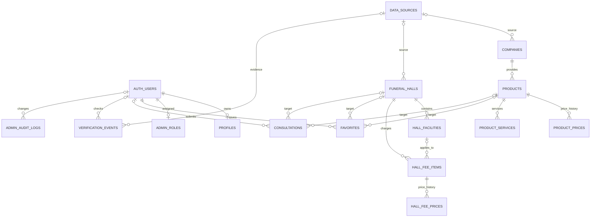

# Funeral Platform Phase 3 백엔드 설계안

작성일: 2026-11-16. 기존 Phase 3 설계와 승인된 회원·비회원 상담 정책을 반영한 검토안이다. 이전에 작성된 것으로 보고한 동일 문서는 현재 작업 폴더에서 확인되지 않아 새로 작성했다.

동반 SQL: [phase-3-migration-draft.sql](./phase-3-migration-draft.sql). 웹·앱 코드는 변경하지 않았고 DB 생성·접속·실행은 하지 않았다. SQL은 Supabase 환경을 대상으로 전체 스키마와 권한을 작성한 **미실행 초안**이다. 실제 문법·정책·동시성 테스트와 환경별 권한 검증이 끝나기 전까지 실행 가능성이 확인된 완성본으로 간주하지 않는다.

## 1. 기존 구현과 차이

| 영역 | 현재 구현 | 연동 시 필요한 작업 |
|---|---|---|
| 공통 타입 | `MutualAidProduct`, `FuneralHall`, `Money`, `DataSource` | 가격 기준일·추정 여부·미확인 값·이력 추가 |
| 샘플 | `demo-data`에 가상 상품 5개, 시설 5개. 별도 `DemoProduct`, `DemoFuneralHall` 사용 | 공통 화면 모델 및 데이터 변환 계층을 추가하고 샘플을 독립 제공자에 유지 |
| 계산 | 월 납입액 × 개월 수; 샘플 시설의 3일 합계 | 단위·조건이 맞을 때만 비교하고 미확인을 0원으로 표시하지 않음 |
| 상담 | 이름·전화·동의·상품/시설 ID의 Zod 검증. 실제 저장 없음 | 상담 내용·동의 버전 추가, 서버 재검증·실제 접수·회원 내역 조회 |
| API | `api-client`는 Supabase 클라이언트 생성 함수만 제공 | 조회·인증·관심·상담 인터페이스와 샘플/Supabase 제공자 추가 |
| 상태 | 웹·앱의 React 메모리 상태. 재시작·새로고침 시 초기화 | 인증 후 관심 목록 동기화. 비교 목록은 초기에는 현재 동작 유지 |
| 환경 | 빈 환경변수 템플릿, Migration/seed는 `.gitkeep`만 존재 | 승인된 환경의 설정과 마이그레이션은 이후 별도 작업 |

현재 웹 상세 및 비교 화면에는 미확인 금액을 `0`으로 대체하는 코드가 있다. 실제 연동 전에 `확인 필요`로 바꿔야 한다. 현재 `Demo*` 타입은 실제 데이터와 공통으로 사용하기에 부적절하므로 화면용 공통 타입을 추가하되 기존 샘플 패키지를 유지한다. 실제 시설 요금은 시간·일, 크기, 추가 조건이 다를 수 있어 샘플의 단순 3일 합계를 일반화하지 않는다.

## 2. 전체 ERD



`verification_events`와 `admin_audit_logs`는 대상 종류와 ID로 여러 표를 참조한다. 이 다형 참조는 일반 FK로 대상 존재를 강제할 수 없으므로 서버 경로에서 확인한다. 프로필·관리자 계정은 모두 Supabase의 `auth.users`를 사용하고, 비밀번호를 별도 저장하지 않는다.

## 3. 전체 테이블과 컬럼

`uuid`는 고유번호, `text`는 글자, `bigint`는 원 단위 정수, `numeric`은 소수, `boolean`은 참/거짓, `date`는 날짜, `timestamptz`는 시간, `jsonb`는 구조화된 자료다. `?`는 NULL 허용이다. 세부 기본값·제약·인덱스는 동반 SQL이 기준이다.

| 테이블 | 컬럼 | 관계·역할 |
|---|---|---|
| `public.profiles` | `user_id uuid PK`, `display_name text?`, `created_at timestamptz`, `updated_at timestamptz` | 로그인 사용자와 1:1, 최소 프로필 |
| `private.admin_roles` | `user_id uuid PK`, `role text`, `created_at timestamptz` | 사용자별 admin/editor/counselor 권한. API에 직접 노출하지 않음 |
| `public.data_sources` | `id uuid PK`, `name text`, `url text?`, `source_type text`, `published_at date?`, `is_published boolean`, `created_at timestamptz` | 공개용 출처. 내부 메모·비공개 연락처는 저장하지 않음 |
| `public.companies` | `id uuid PK`, `name text`, `summary text?`, `source_id uuid?`, `checked_at timestamptz?`, `verification_status text`, `information_origin text`, `is_published boolean`, `created_at timestamptz`, `updated_at timestamptz` | 회사와 출처 |
| `public.products` | `id uuid PK`, `company_id uuid`, `name text`, `description text?`, `is_sponsored boolean`, `source_id uuid?`, `checked_at timestamptz?`, `verification_status text`, `information_origin text`, `is_published boolean`, `created_at timestamptz`, `updated_at timestamptz` | 회사별 상품. 광고 여부 별도 표시 |
| `public.product_prices` | `id uuid PK`, `product_id uuid`, `total_price_krw bigint?`, `monthly_payment_krw bigint?`, `payment_months integer?`, `terms text?`, `effective_from date`, `recorded_at timestamptz`, `source_id uuid?`, `checked_at timestamptz?`, `verification_status text`, `information_origin text`, `supersedes_id uuid?` | 상품의 가격·납입 조건 이력 |
| `public.product_services` | `id uuid PK`, `product_id uuid`, `name text`, `service_type text`, `quantity numeric?`, `unit text?`, `additional_cost_krw bigint?`, `conditions text?`, `source_id uuid?`, `checked_at timestamptz?`, `verification_status text`, `information_origin text` | 포함·제외·추가비용 |
| `public.funeral_halls` | `id uuid PK`, `name text`, `region text`, `district text?`, `address text`, `latitude numeric?`, `longitude numeric?`, `summary text?`, `source_id uuid?`, `checked_at timestamptz?`, `verification_status text`, `information_origin text`, `is_published boolean`, `created_at timestamptz`, `updated_at timestamptz` | 장례식장 |
| `public.hall_facilities` | `id uuid PK`, `hall_id uuid`, `name text`, `facility_type text`, `quantity integer?`, `details text?`, `source_id uuid?`, `checked_at timestamptz?`, `verification_status text`, `information_origin text` | 빈소·주차 등. 식장당 다수 |
| `public.hall_fee_items` | `id uuid PK`, `hall_id uuid`, `facility_id uuid?`, `name text`, `fee_type text`, `conditions text?` | 요금 항목. 시설을 지정하면 같은 식장의 시설이어야 함 |
| `public.hall_fee_prices` | `id uuid PK`, `fee_item_id uuid`, `amount_krw bigint?`, `billing_unit text`, `conditions text?`, `effective_from date`, `recorded_at timestamptz`, `source_id uuid?`, `checked_at timestamptz?`, `verification_status text`, `information_origin text`, `supersedes_id uuid?` | 요금 항목별 이력 |
| `private.verification_events` | `id uuid PK`, `target_type text`, `target_id uuid`, `source_id uuid?`, `status text`, `checked_at timestamptz`, `checked_by uuid?`, `note text?`, `created_at timestamptz` | 내부 검증 내역. 메모 비공개 |
| `private.admin_audit_logs` | `id bigint PK`, `actor_id uuid?`, `target_type text`, `target_id uuid`, `action text`, `before_data jsonb?`, `after_data jsonb?`, `created_at timestamptz` | 관리자 변경 이력. 상담은 상태만 기록 |
| `public.favorites` | `id uuid PK`, `user_id uuid`, `product_id uuid?`, `hall_id uuid?`, `created_at timestamptz` | 사용자 관심. 상품·시설 중 정확히 하나, 중복 금지 |
| `public.consultations` | `id uuid PK`, `user_id uuid?`, `requester_type text`, `name text`, `phone text`, `message text`, `product_id uuid?`, `hall_id uuid?`, `consented_at timestamptz`, `consent_version text`, `status text`, `retention_until timestamptz`, `created_at timestamptz`, `updated_at timestamptz` | 회원·비회원 상담 통합. 비회원은 user_id 없음 |

`verification_status`: verified/unverified/needs_review. `information_origin`: provider/public_source/platform_estimate/unknown. 출처와 검증 상태는 독립적으로 표시한다. SQL은 검증 완료 데이터에 출처와 확인일을 요구한다. `service_type`: included/excluded/additional. 추가비용·조건은 항목별로 표시한다.

## 4. 가격 이력 및 데이터 신뢰성

- 가격 데이터는 새 행을 추가한다. UPDATE/DELETE를 정책과 트리거로 차단하며, 관리자 작업도 감사 테이블에 기록한다.
- `effective_from`이 조회 기준일 이하인 가격 중 적용일이 가장 최근인 것을 선택한다. 미래 가격은 적용 전까지 현재 금액이 아니다. 과거 기준일 조회에는 그 날짜 이전 기록을 사용한다.
- 같은 날짜의 정정은 기존 행을 `supersedes_id`로 참조하며, 같은 상품 또는 같은 요금 항목과 같은 적용일이어야 한다. 하나의 기록을 두 번 정정하는 분기 입력은 유일 인덱스로 막는다. 같은 날짜 가격의 표시 순서는 `effective_from DESC, recorded_at DESC, id DESC`다. `recorded_at`은 DB가 부여한다. 가격의 유효성 판단과 변경 작업은 트랜잭션에서 처리한다.
- 금액 NULL은 미확인이고 0은 무료다. JavaScript 안전 정수 범위를 넘어서는 금액은 SQL에서 허용하지 않는다.
- 상품·시설 정보 및 가격에는 출처, 확인 시각, 검증 상태, 정보 유래를 기록한다. 출처의 민감한 내부 메모는 공개 테이블에 저장하지 않는다. 검증 이벤트는 별도 기록한다.
- 상품 서비스 구성은 현재 상태와 변경 감사 기록만 보관한다. 과거 시점의 정확한 상품 구성을 재현하려면 별도의 구성 버전이 필요하며 현재 범위에는 포함하지 않는다.

## 5. 접근 주체별 RLS 및 관리자 권한

SQL은 공개 스키마의 각 표에 RLS를 켜고 명시적으로 권한을 부여한다. `private` 스키마는 API 노출 대상에서 제외해야 한다. 관리자 판단은 클라이언트가 바꿀 수 있는 메타데이터가 아닌 `private.admin_roles`를 조회하는 보안 함수로 수행한다. 이 함수의 소유자, 고정 `search_path`, EXECUTE 권한을 실제 Supabase 환경에서 확인한다.

| 테이블 | 비회원 anon | 일반 회원 authenticated | 관리자 |
|---|---|---|---|
| 출처·회사·상품·시설 | 공개 행만 SELECT | 공개 행만 SELECT | admin/editor는 비공개 포함 조회·등록·수정. 삭제는 admin |
| 상품 서비스·시설·요금 항목 | 상위 회사·상품 또는 식장이 공개된 행만 SELECT | 동일 | admin/editor 조회·등록·수정, 삭제는 admin |
| 상품 가격·시설 가격 이력 | 공개 상위 데이터의 이력 SELECT | 동일 | admin/editor 조회·INSERT만. UPDATE/DELETE 불가 |
| 프로필 | 접근 불가 | 본인 SELECT/INSERT/UPDATE | 다른 사람의 프로필은 기본 접근 불가 |
| 관심 목록 | 접근 불가 | 본인 SELECT/INSERT/DELETE. 저장 시 공개 대상인지 확인 | 타인 목록에 기본 접근 불가 |
| 상담 | 직접 조회·등록 불가 | 본인 SELECT. 직접 INSERT/UPDATE 불가 | admin/counselor는 SELECT 및 상태 업데이트 |
| 관리자 역할·검증 이력·감사 이력 | 접근 불가 | 접근 불가 | 직접 API 접근 불가. 권한 검사한 서버 경로만 사용 |

공개 가격에는 미래 이력도 포함된다. UI의 현재 가격은 기준일 조건으로 선택한다. 미래 가격을 사전에 공개하지 않으려면 별도 공개 플래그가 필요하며 정책 확정 후 추가한다. 원본 `terms`, `conditions`, URL 등은 공개 텍스트로 취급하므로 개인정보나 비공개 계약 조건을 입력하지 않는다.

`admin`은 상품/시설 관리와 상담 처리, `editor`는 상품/시설 관리, `counselor`는 상담 처리를 맡는다. 역할 부여·회수와 최초 admin 등록은 별도 승인된 서버 운영 절차로 처리하며 일반 계정이 직접 수정하지 못한다. 상담 상태 변경 감사에는 이름·전화·상담 내용이 들어가지 않는다. 상품 데이터의 변경 전후는 감사에 저장되므로 해당 필드에 개인정보를 입력하지 않는다.

가격·상품의 쓰기와 감사 기록은 SQL 트리거가 같은 트랜잭션으로 처리한다. 다만 검증 이벤트는 서버에서 데이터 변경과 같은 트랜잭션으로 작성해야 하며, 이를 위한 RPC 또는 트랜잭션 서버 코드는 구현 단계에 추가해야 한다. SQL 초안의 private 이벤트/감사 테이블은 일반 사용자에게 직접 권한을 주지 않는다.

## 6. 회원·비회원 상담 API 및 개인정보

권장 경로: 웹 또는 모바일 → Supabase Edge Function `submit-consultation` → 서버 측 입력·동의·요청 검증 → 서비스 전용 권한으로 `consultations` INSERT → 접수 성공 여부만 반환. 현재 단계에서는 함수 설계만 하며 구현·배포하지 않는다.

1. 화면에서 이름, 연락처, 상담 희망 내용, 선택한 상품·시설과 동의 여부를 입력받는다. 회원의 이름·전화는 확인 후 수정할 수 있도록 제안하되, 표시된 값이 항상 최신이라고 가정하지 않는다.
2. 회원 요청은 서버가 검증한 세션의 사용자 ID를 사용한다. 비회원의 `user_id`는 NULL이다. 클라이언트가 보낸 사용자 ID·처리 상태·동의 시각·보관 만료일은 신뢰하지 않는다. 인증 토큰이 유효하지 않은 요청을 비회원으로 조용히 취급하지 않는다.
3. 서버는 이름·연락처·내용 길이, 동의 여부, 현재 게시된 상품·시설과 동의 문구 버전을 재검증한다. 동의 시각과 처리 상태, 보관 만료일은 서버가 결정한다.
4. 접수 성공 시 비회원에게 성공/실패만 보여 주고 개인정보, DB ID, 조회 링크를 반환하지 않는다. 회원은 로그인 후 본인 내역만 조회한다. 상담 내역 접근 제어는 RLS로 다시 확인한다.
5. 서비스 역할 키는 Edge Function 서버 비밀 설정에만 보관하고 웹·앱·로그에 넣지 않는다. 요청 본문·전화번호·상담 내용을 일반 로그나 감사 기록에 남기지 않는다.
6. IP와 기기 단위 요청 제한, 중복 전송 제한, 자동화 탐지 및 모니터링을 서버 앞단에 설계한다. 제한 수치는 운영 전 실제 트래픽에 맞춰 정한다. 클라이언트 버튼 비활성화만으로는 스팸을 막을 수 없다. 원본 IP의 장기 보관은 피하고 제한 저장소의 보관 기간과 실패 시 동작을 명시한다.

동의 문구는 버전별로 변경 불가능하게 별도 문서·운영 저장소에서 보관하고, 신청 행에는 사용자가 동의한 `consent_version`과 서버의 `consented_at`을 기록한다. 기존 SQL의 `retention_until`은 만료 판별을 위한 값이다. 구체적인 보유 기간, 삭제 요청 및 관련 법령상 보존 예외는 운영자와 검토하여 출시 전 확정한다. 만료 처리는 권한이 제한된 서버 작업으로 개인정보 삭제/익명화하고 결과를 개인정보 없는 운영 기록에 남긴다. 백업 만료, 복구 시 재삭제, 회원 탈퇴 시 분리 처리까지 정책에 포함해야 한다. 현재 SQL은 자동 파기 작업을 생성하지 않는다.

## 7. 웹·모바일 공통 API

```text
웹 ─────┐
        ├─ @funeral/api-client ─ 샘플 제공자 / Supabase 제공자
모바일 ─┘                              └─ 상담 Edge Function
```

공통 인터페이스 예시: `listProducts`, `getProduct`, `listFuneralHalls`, `getFuneralHall`, `listFavorites`, `addFavorite`, `removeFavorite`, `submitConsultation`, `listMyConsultations`. 상품/시설 비교는 최대 3개 ID를 조회해 같은 기준으로 비교한다. 샘플 제공자는 기존 기능을 계속 지원하고 실제 데이터와 섞지 않는다. 웹·앱 인증 세션 저장은 각 플랫폼에 맞게 처리한다. API 실패, 빈 결과, 로딩, 미확인 가격은 각각 구분한다.

## 8. 기존 코드 변경 계획

구현 승인 후 `packages/shared-types/src/index.ts`, `packages/shared-logic/src/index.ts`, `packages/validation/src/index.ts`, `packages/api-client/src/index.ts`, `packages/demo-data/src/index.ts`, 웹의 `apps/web/app`·`apps/web/src/components`·`apps/web/src/state/platform-state.tsx`, 앱의 `apps/mobile/src/app`·`apps/mobile/src/components`·`apps/mobile/src/providers/app-state.tsx`를 단계적으로 수정한다. 실제 Migration은 `supabase/migrations`에 신규 파일로 작성한다. `.env.example`은 공개 URL·공개 키 자리표시자만 보강하고 실제 비밀은 넣지 않는다. 이 단계에서는 위 파일을 변경하지 않았다.

## 9. 검증 계획

실제 실행 전 독립된 로컬 Supabase 환경에서 Migration을 빈 DB에 적용해 오류를 확인하고 재생성한다. 실제 DB 적용은 별도 승인 후 백업과 복구 연습을 마친 다음 진행한다.

- 가격: 과거·오늘·미래 적용일, 동일 날짜 정정 체인, 잘못된 대상 정정, 동시 정정, 0원·NULL, 안전 정수 초과, UPDATE/DELETE 거부, 조회 순서 검증.
- RLS: anon·회원 A·회원 B·editor·counselor·admin·service_role 각각의 직접 REST/SQL 접근. 상위 업체 비공개 시 하위 가격 누출, private 스키마 노출, 함수 실행 권한, 역할 위조·확대, 다른 사용자의 관심/상담 접근을 검사.
- 상담: 회원·비회원 성공, 만료/위조 토큰, 무동의·잘못된 버전, 비공개 대상, 입력 길이·주입, 중복·요청 폭주, 실패 시 DB 기록 여부, 비회원 조회 거부, 개인정보 로그 유출을 검증.
- 관리: 변경과 감사 기록의 원자성, 실패 시 롤백, 상담 로그의 개인정보 제외, 최초 관리자 등록과 권한 회수 및 세션 반영을 검증.
- 수명주기: 만료 파기·삭제 요청·회원 탈퇴·백업 복구 후 재파기 절차와 실제 보유 기간의 일치 여부를 검사.
- 기존 화면: 샘플 모드 회귀, 웹·앱 검색·정렬·비교·관심·상담 진입, 타입 검사·린트·기존 테스트와 신규 보안 테스트를 실행한다.

## 10. 실행 및 롤백 계획

현재는 SQL을 실행하지 않는다. 승인된 로컬 환경에서만 별도 테스트 데이터로 검증하고, Supabase 버전과 함수 소유자·기본 권한, RLS 및 exposed schema 설정을 확인한다. 검증이 끝난 Migration을 새 파일로 `supabase/migrations`에 넣고 운영 적용은 별도 승인받는다.

적용 전 백업 및 복구 지점·복구 소요 시간을 확인하고 서버 읽기/쓰기 중단 또는 이전 버전 호환 방식으로 전환한다. 문제가 발생하면 먼저 접수·관리 쓰기를 중지하고 이전 앱을 샘플 또는 이전 API로 되돌린다. 운영 데이터가 생긴 뒤에는 `DROP TABLE`로 되돌리지 않는다. 스키마 변경은 데이터 보존형 역방향 Migration을 별도 작성·검증하고, 복구가 필요하면 승인된 백업을 격리 환경에 복원해 확인 후 복구한다. 개인정보를 포함한 백업의 접근·보유·삭제 및 복원 후 재파기도 함께 적용한다. 이 SQL은 역방향 자동 스크립트를 제공하지 않는다.

## 11. 이후 작업

1. 이 문서와 SQL에 대한 검토 및 구현 승인.
2. 서버의 검증 이력 원자적 기록, 관리자 역할 운영, 상담 함수, 요청 제한 및 개인정보 파기 정책을 완성.
3. 승인된 독립 로컬 DB에서 전체 SQL과 RLS 검증. 현재 환경에서는 실행하지 않음.
4. 공통 API와 샘플 모드·웹·모바일을 단계적으로 연동.
5. 별도 승인 후 Supabase 연결·환경 설정·운영 적용.
